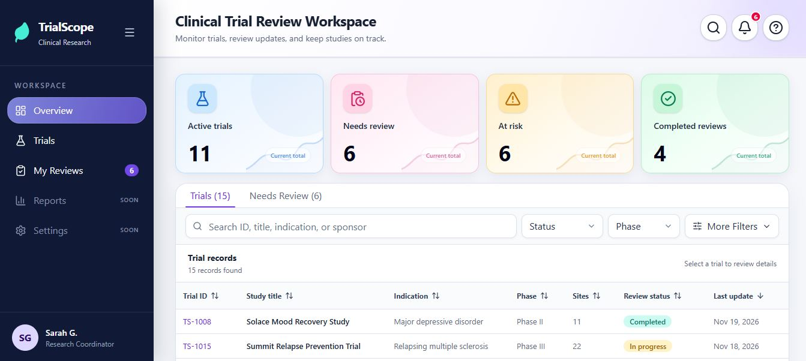

# TrialScope

**Clinical Trial Review Workspace**  
Frontend Engineer technical exercise — Tilda Research

TrialScope is a small, self-contained workspace for reviewing clinical trial records. It brings a study list, review status, key study information and reviewer notes into one place, with enough interaction to demonstrate how I would structure and deliver an enterprise React interface.

This is a frontend demonstration, not a clinical system. All studies and sponsors are fictional. It does not contain patient information, connect to a clinical trial registry, or make clinical recommendations.


## Application Preview



The dashboard provides an overview of active trials, studies requiring review, at-risk studies, and completed reviews. Reviewers can search, filter, and sort trial records before opening a study to inspect its details and manage review activity.


## MVP Scope

I approached TrialScope as a focused frontend MVP rather than attempting to recreate a complete clinical trial management platform.

The primary workflow is straightforward: identify studies requiring attention, review their details, record observations, and mark reviews complete.

### Included in the MVP

- Dashboard metrics for active trials, pending reviews, at-risk studies, and completed reviews.
- Fifteen fictional clinical trial records with consistent study metadata.
- Search, filtering, sorting, and pagination.
- Study details with Overview, Sites, Documents, and Activity sections.
- Review notes and review-completion actions.
- Local persistence through browser localStorage.
- Loading, empty, error, and retry states.
- Responsive layouts for desktop and smaller screens.
- Keyboard interactions, focus management, and accessible UI patterns.
- Automated tests covering trial selectors and repository behavior.

### Outside the MVP

Authentication, role-based access control, backend APIs, real-time collaboration, external clinical trial integrations, and production-grade audit logging are deliberately excluded.

These would be necessary for a production clinical research platform, but they would not materially improve the core frontend workflow demonstrated in this exercise.

### Validation

The current implementation has passed 27 automated tests across two test files, ESLint checks, TypeScript compilation, and a production build.

Key keyboard interactions were also manually verified. Full WCAG 2.1 AA conformance has not been independently audited.


## The problem I chose to solve

A reviewer working across multiple studies needs to answer a few questions quickly: Which studies need attention? Which reviews are overdue or high priority? What is the context for a particular study? Has someone already reviewed it, and what did they record?

When these answers are scattered across a spreadsheet, a study summary and separate notes, even straightforward review work becomes harder to track. TrialScope puts the review queue and study context together. A reviewer can narrow a list of studies, inspect a record, add an activity note and mark the review complete without losing their place.

The goal was not to reproduce a full clinical trial management system. It was to build a focused review workflow, make its state transitions credible, and show how the UI behaves under normal, empty, loading and failure conditions.

## Intended user

The primary user is a **clinical operations or research review coordinator** who monitors a portfolio of studies and records administrative review progress. A secondary user might be a team lead checking workload and outstanding reviews.

I designed for someone who spends time in data-heavy interfaces: the study list is scannable, review status is separate from study status, filters are close to the table, and details can be inspected without navigating away from the workspace. The UI deliberately avoids implying that a completed *review* means a completed *clinical study*.

## What is implemented

- **Review dashboard:** Summary cards for active studies, reviews needing attention, at-risk reviews and completed reviews. Counts are derived from the underlying records rather than maintained as separate counters.
- **Fictional but coherent data:** 15 clinical trials with identifiers, titles, indications, sponsors, phases, study/review statuses, priorities, dates, site counts, participant counts, summaries and review notes.
- **Finding studies:** Case-insensitive search across trial ID, title, indication and sponsor; review-status, phase and study-status filters; clear/reset behavior; sortable table columns and six-record pagination.
- **Study details:** Overview, Sites, Documents and Activity tabs. The overview exposes key study context. Activity shows saved review notes. Sites and Documents explicitly explain when detailed records are unavailable rather than displaying invented content.
- **Review actions:** Add a note with validation and feedback; mark an outstanding review complete; update the table and dashboard metrics; prevent duplicate completion through the disabled completed state.
- **Persistence:** Changes are saved in browser `localStorage` and survive a page refresh in the same browser. Invalid saved data is rejected and the demonstration dataset is restored.
- **Application states:** Loading skeletons, no-results messaging, simulated repository failure with a recoverable Retry flow, and feedback for successful or failed review actions.
- **Responsive UI:** Desktop workspace, tablet layout and mobile navigation drawer. The data table scrolls horizontally at narrow widths rather than squeezing clinical fields into unreadable columns.
- **Keyboard interaction:** Keyboard-operable table actions and detail tabs; focus moves into the trial details panel on open; Escape closes it; focus returns to the originating trial when it is still present. The note form uses a native modal dialog.

## Run locally

**Prerequisites:** A current Node.js version compatible with the project's Vite version (Node.js 20.19+ or 22.12+), and npm. I recommend a current Node.js LTS release.

```bash
npm install
npm run dev
```

Open the local URL printed by Vite (normally `http://localhost:5173`).

To verify the project:

```bash
npm run test
npm run lint
npm run build
npm run preview
```

`npm run test` uses Vitest to run the automated tests once. `npm run lint` runs ESLint. `npm run build` runs TypeScript's build check followed by a production Vite build. `npm run preview` serves the generated production build locally.

The project does not need API credentials, a database, or a `.env` file. **Note:** The submitted project must include the final `test` script and Vitest dev dependency; they were added during implementation and are not part of the original Vite starter template.

## Architecture

I kept the code feature-oriented without introducing an application framework or global state library for a problem of this size.

```text
src/
  app/                         Application shell and navigation
  components/ui/               Shared Button, StatusBadge, EmptyState
  data/mockTrials.ts           Fictional trial records
  features/trials/
    components/                Dashboard, filters, table, detail panel
    hooks/useTrials.ts         Loading, mutation and retry orchestration
    services/trialRepository.ts Persistence and asynchronous data operations
    utils/trialSelectors.ts    Search, filter, sort, lookup and metrics
    types.ts                   Trial domain and UI contracts
  styles/tokens.css            Design tokens
  index.css                    Global styles
```

### Data flow

```text
mockTrials / localStorage
          |
          v
   trialRepository
          |
          v
       useTrials
          |
          v
  TrialDashboard state
    |       |       |
 search   filters  sorting
    \       |       /
     derived selectors
          |
       pagination
          |
       TrialTable ---- select trial ---> TrialDetailPanel
                                             |
                                      note / complete
                                             |
                                      trialRepository
                                             |
                                   updated trial -> UI
```

**Repository:** `trialRepository` is the boundary around reading and updating trial data. It exposes asynchronous operations (`getTrials`, `addReviewNote`, `completeReview`) even though the current persistence is local. That keeps storage details out of rendering components and gives the UI realistic loading and failure paths.

**Hook:** `useTrials` owns the remote-like loading lifecycle (`loading`, `success`, `error`), retry behavior and mutations. It replaces an updated record in React state after persistence succeeds. Its in-flight request handling also avoids redundant simultaneous initial reads.

**Selectors:** Searching, filtering, sorting, lookup and KPI calculations are pure functions. This makes the rules explicit and independently testable. The dashboard derives the visible list from the source records, then paginates it. It does not store a second mutable copy of filtered results.

**Components:** The dashboard coordinates the workflow; the table displays and selects records; filters only collect criteria; the detail panel owns its tabs and note form. Shared UI primitives keep repeated styles and status treatments consistent. Props and TypeScript domain types make boundaries understandable without an extra abstraction layer.

## Important technical decisions

### React state instead of a global store

The dataset and interaction surface are small. A repository-backed hook plus local component state is easier to follow than Redux or another store here. Persistent trial data is managed centrally; transient state such as search text, selected page, active tab and dialog visibility stays close to the components that use it. If this became a multi-screen application with server caching, I would reassess that choice.

### Deterministic derived data

The selector functions avoid mutating their input arrays. Sorting is stable, including a tie-breaker using the original index. Search normalizes case and whitespace. The metric function receives a reference date, so overdue logic can be tested without relying on the machine clock inside the selector.

The dashboard's **Active trials** metric includes active and recruiting studies. **Needs review** counts records with review status `needs-review`. **At risk** means an incomplete review that is overdue or high priority. **Completed reviews** counts completed review statuses, independently of study status. These are demonstration business rules, not clinical risk assessments.

### Browser persistence as a deliberate boundary

`localStorage` makes a stateful workflow possible without asking reviewers to configure a backend. Saved data is validated before use, and nested note arrays are copied when records are returned. This is appropriate for a take-home exercise, **not** for regulated clinical data or collaborative use: there is no authentication, authorization, audit-grade history, concurrency control, encryption policy or server-side source of truth.

### Loading and errors are part of the interface

The repository uses short asynchronous delays so loading and saving states can be exercised. Failures are represented as explicit UI states rather than swallowed. The error/retry experience was manually verified with a temporary development-only simulation; that simulation was removed afterward. The repository's failure and recovery behavior also has automated test coverage.

### Accessibility is a workflow requirement

The interface uses semantic controls and table markup, associated form labels, descriptive accessible names, `aria-sort` for sortable columns, `aria-current="page"` for pagination, status/error announcements and keyboard-operable tabs. The details panel was improved after keyboard testing: opening a trial moves focus into the panel, Escape closes it, and closing restores focus to the originating trial when available. The Add Note form uses the browser's native `<dialog>` modal behavior.

These are implemented accessibility measures, not a claim of WCAG certification. A complete assistive-technology and automated accessibility audit remains future work.

### Responsive behavior favors readability

At mobile sizes the sidebar becomes a drawer and the summary cards stack. A horizontally scrollable table is preferable to hiding essential study columns or compressing them beyond readability. The detail experience adapts to smaller viewports. Mobile and tablet layouts were manually checked at 375px and 768px; desktop layout was exercised during the functional QA pass.

## Testing and verification

The final local verification reported:

| Check | Result |
| --- | --- |
| `npm run test` | **27 passed / 27 total**, across 2 test files |
| `npm run lint` | Passed |
| `npm run build` | Passed: TypeScript build and Vite production bundle |

### Automated tests — 27 cases

**`trialSelectors.test.ts` — 19 tests.** These exercise the pure data rules for search, filters, sorting, metric calculations and trial lookup. In particular, the suite checks how records are selected and ordered without needing to render the React interface.

**`trialRepository.test.ts` — 8 tests:**

1. Loads the initial fictional dataset.
2. Returns an error for a simulated loading failure and succeeds on retry.
3. Marks a review complete and persists the changed status.
4. Trims and saves a review note, then returns it after reload.
5. Rejects a blank review note.
6. Rejects updates to an unknown trial ID.
7. Recovers from malformed saved JSON.
8. Returns independent copies rather than exposing shared mutable records.

The suite is intentionally strongest at the domain and persistence boundaries. It does **not** currently include automated React component tests, end-to-end browser tests, or a formal accessibility audit; those would be the next testing investments.

### Manual functional QA

The following interactions were exercised in Chrome during development:

| Area | Verification performed |
| --- | --- |
| Search | Search by trial ID; clear search and restore all 15 records |
| Review filters | Needs review, In progress, Completed and All |
| Phase filters | Phase I–IV and All Phases |
| Study-status filter | Active, Recruiting, Completed, Paused; clear combined filters |
| Sorting | Trial ID, site count and last-update order, both directions |
| Pagination | Navigate across three pages; selected page indicator and displayed record range |
| Details | Open/close a study; Overview, Sites, Documents and Activity tabs |
| Notes | Add a review note; see it in Activity; refresh and confirm persistence |
| Review completion | Mark a review complete; verify status and KPI update; refresh and confirm persistence |
| Empty results | Unmatched search displays an informative zero-results state |
| Loading | Skeleton appears before trial data loads |
| Failure and retry | Error screen, Retry action and successful recovery without losing saved changes |
| Responsive | Mobile 375px and tablet 768px, including navigation drawer and details |
| Keyboard | Tab/Enter navigation, detail-panel focus entry, Escape close and focus restoration |

Manual QA is evidence of exercised workflows, not a substitute for repeatable automated browser coverage.

## Libraries and why I selected them

| Technology | Reason |
| --- | --- |
| **React 19** | Component-based UI with straightforward hooks and predictable state updates |
| **TypeScript** | Explicit domain models and safer contracts between data, state and presentation |
| **Vite 8** | Fast local development and a simple production build for a client-only application |
| **Tailwind CSS 4** | Consistent responsive styling with low CSS overhead for this scope |
| **CSS design tokens** | Centralized colors, surfaces, spacing and reusable visual decisions |
| **Lucide React** | Lightweight, consistent SVG iconography with accessible labeling at the control level |
| **Vitest** | Fast, focused unit tests that fit the Vite toolchain |
| **ESLint** | Baseline static checks and React hooks rules |
| **Browser localStorage** | Demonstrates persistence and state changes without backend infrastructure |

I deliberately did not add a routing library, API client, component framework or global state manager: the current workflow does not justify the additional dependencies.

## Assumptions and trade-offs

- **Fictional data only.** The study records are coherent enough to support review workflows, but they are not sourced from a real registry and must not be treated as clinical facts.
- **Single-browser persistence.** Data survives refreshes in that browser, but it does not synchronize across devices, users or sessions on different origins. Clearing browser storage resets the demo.
- **Review status and study status are separate.** A completed review does not change the study's recruitment or completion status.
- **Simplified permissions.** The demo assumes a reviewer may view and update every record; it does not model roles or approval chains.
- **No real site/document records.** Those tabs explain the absence of deeper data rather than pretending it exists.
- **Small dataset.** Client-side search, sort and pagination are appropriate for 15 records. Server-side querying and virtualization would be evaluated at scale.
- **No backend audit trail.** Notes and status changes demonstrate interaction, not a compliant immutable history.
- **No clinical risk scoring.** “At risk” is a review-workflow rule based on due date and priority, not a medical or safety assessment.

## What I would build next

Given more time, I would prioritize work in this order:

1. **End-to-end and accessibility regression tests:** React Testing Library for component behavior; Playwright for search, note saving, review completion, keyboard navigation and focus restoration; axe and screen-reader checks for accessibility.
2. **Backend and authentication:** Replace browser storage with an authenticated API, server-side validation, authorization, concurrency handling and audit-grade change history.
3. **Richer review workflow:** Assignments, review ownership, due-date alerts, review comments, approval states and a clear activity timeline.
4. **Real site and document models:** Typed site records, document metadata, attachments and appropriate loading/error states.
5. **Scalability and observability:** Server-side filtering/pagination, query caching, telemetry, error reporting and measured performance budgets using production profiling and Core Web Vitals.
6. **Broader accessibility verification:** Screen-reader walkthroughs, zoom/reflow testing, reduced-motion checks and documented WCAG 2.2 AA audit results.

## Submission

- **Source code:** GitHub repository link — *add after publishing*
- **Live application:** Vercel deployment link — *add after deployment (optional)*

To evaluate locally, clone the repository, run `npm install`, then `npm run dev`. No external service or credentials are required.

---

*Built as a focused frontend engineering exercise: a clear review workflow, explicit data boundaries, predictable state changes and accessibility considered as part of interaction design rather than a final visual pass.*
